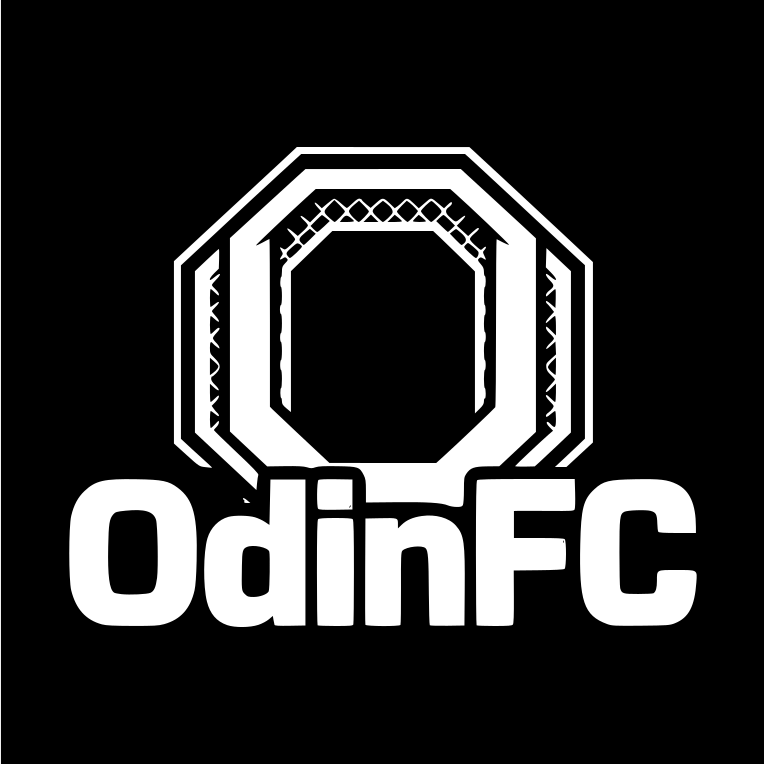

# OdinFC - a Muay Thai championship simulator

## Model work

1. Install a working Blender. The Fedora package on your machine is broken: it crashes on start with a MaterialX error, which I hit during the animation work. Use the official build instead, either the tarball from blender.org (unpack and run, no install) or the Flathub Flatpak (flatpak install flathub org.blender.Blender). Either avoids the broken system libraries.

2. Don't start from a blank mesh. Sculpting a believable body from scratch is a big job. Two quicker starting points:

MPFB2: a free Blender add-on (MakeHuman inside Blender). It generates a rigged human with sliders for height, weight, muscle and proportions. A lean 174 cm / 71.5 kg build like Buakaw's takes minutes.
KeenTools FaceBuilder: a paid add-on that builds a head mesh from photos. It's the realistic way to get a recognisable face; doing it by hand takes real sculpting skill.
You'd then add shorts, hair, armbands and ankle supports as separate pieces.

3. Rules a model must follow so every existing animation works on it unchanged:

Requirement	Why
Rigged with Mixamo bone names (mixamorig:Hips, …)	All clips and the generated kicks target that skeleton. The easiest route is to upload the finished mesh to mixamo.com's auto-rigger and download it with skin.
T-pose rest pose, real-world scale (metres), facing +Z	Matches the current character, so the clips line up.
Separate materials for skin, shorts, hair, etc.	Lets the game tint them from each fighter's data file (skin tone, shorts colour) and swap gloves to the corner colour.
About 15–30k triangles per fighter	Keeps 60 fps on your integrated GPU with two fighters plus the crowd.
Export as glTF (.glb)	Godot imports glTF more reliably than FBX. FBX also works, as with the current Mixamo files.
4. Code side (small, I can do it): add a model_path field to each fighter's data file and have the fighter model load that file instead of the one hard-coded character. Fighters without a custom model keep the current mannequin.

A good first test: make a rough MPFB2 body at Buakaw's measurements, put it through Mixamo's auto-rigger, and drop it in. That proves the whole pipeline before you spend hours on likeness details. Want me to add the model_path support now, so a test model can go straight in when it's ready?